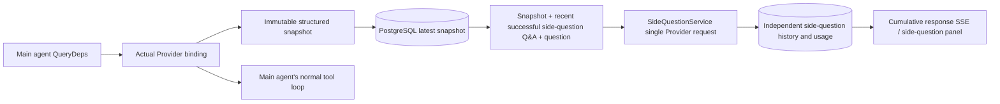

# ARTEX `/btw` Side Questions

English · [한국어](README.ko.md) · [中文](README.zh.md)

Regular chat, the task's MainAgent, and Workers launched directly by the current task each support side questions separate from the main conversation. Typing `/btw <question>` in the main input submits a side question; typing only `/btw` with no content, or pressing the "Side question" button, opens the previous side-question history. On desktop it is shown as a width-adjustable sidebar, and on mobile as a drawer.

Side-question responses are generated from a snapshot of the agent context at the time the question was submitted, and support streaming display, follow-up questions, stop, and clear. Closing the panel, refreshing the page, or losing the SSE connection does not cancel the model request. Stop affects only the single side question currently in progress, while Clear cancels side questions and deletes the side-question history as well, but leaves the main-context snapshot intact.

> This document is the English translation of the original Chinese document (`README.zh.md`). The original is preserved as-is so that upstream changes are easy to compare.

## Scope of implementation

It uses Go, norma v0.3.7, Next.js, and the existing Markdown, ResizablePanel, Drawer, and AlertDialog components as-is, and neither modifies norma sources nor adds new dependencies for side questions. The Planner, Workers inherited from another task, and promotion of tool-type subtasks are outside this scope.

- `capture.go` marks main-loop requests only in `Options.Deps.CallModel` · `CallModelSync`. Because the Provider decorator sits at the stage after the model is selected inside each individual model, that is, outside the routing pool, it records the model actually selected. Compaction requests and summary requests do not overwrite the snapshot.
- Snapshots are published when a request starts, when the model completes its response, and when execution reaches a terminal state. Half-finished responses during generation are not published. Tool calls are kept paired through norma's `MessagesForAPI`, and tool results enter the snapshot at the next main model request or at the terminal state. If streaming is interrupted, the last valid boundary is retained.
- The snapshot preserves structured messages, the system prompt, tool definitions, and generation parameters through a JSON deep copy. Model inference does not hold a snapshot lock or a database transaction.
- `SideQuestionService` calls an individual Provider. If needed it first creates a side-question summary, and the final response is retried with a reduced context exactly once, and only if the context exceeded the limit for the first time and no text or tool call has been emitted yet. It does not create a new agent session, does not connect to the tool executor, main transcript, activity stream, or task graph, and does not pass through the task model-switching chain. Responses keep tool definitions for compatibility with the existing structured tool context, and summary requests are not given tools. Newly returned tool calls have no execution path.
- Each parent session has one request in flight, with at most four per service process, and a 120-second timeout per request. Side questions use an independent cancellation context under the service lifecycle.
- Side-question requests store a model-configuration reference and a summary of non-sensitive identifying information, and fetch credentials from the existing configuration at request time. If the configuration is deleted or identifying fields such as model, protocol, or address change, they require the main agent to be run first so that the snapshot is refreshed. Tests do not change the product's default model.

## Persistence and recovery

`db/schema.sql` automatically creates the `side_question_sessions` and `side_question_requests` tables. The former stores the parent resource, the latest snapshot, the run number, the version, and the cleanup version; the latter stores the question, cumulative response, status, model, snapshot time, usage, event ordinal, and page ordinal.

Parent session keys use either the conversation ID, or the task ID, exploration ID, and intent ID combined. Workers do not use reusable execution slot names.

Snapshots are merged and written per parent session and flushed once every 250 milliseconds, and the database compares `(run_id, version)` so that an older version cannot overwrite a newer one. The snapshot selected immediately before submitting a side question is saved once more. On a successful save, the large in-memory snapshot is released; on failure, the version not yet written is retained. Cumulative response content is written at most once every 250 milliseconds as streaming events arrive, and terminal states are saved immediately, with a limited number of retries on database errors.

When the service starts, requests left in the `running` state are marked `interrupted`, any partial response and usage already stored in the database are kept as-is, and requests are not automatically re-executed. The most recently successfully saved context can be used immediately for the next question. If an old session has no snapshot, it requires the main agent to be run first, and does not reconstruct context from the UI activity log.

The clear operation increments the cleanup version by one and deletes the requests, and conditional updates prevent a late-arriving callback from writing again. Physical deletion of a parent resource is left to the foreign-key cascade; logical deletion of a Worker deletes the side-question data within the same transaction and then rejects snapshots that arrive afterwards. Archiving a task first blocks new requests, waits for the main flow to stop, cancels side questions, and then waits for them to be persisted. The archive format is v3 and remains compatible with v1 and v2, which have no side-question tables.

History is stored in full, and pages of at most 20 entries are returned based on the ordinal cursor. Model requests re-include the most recent successful Q&A verbatim, up to 20 exchanges, with the amount constrained to fit the token budget, and older Q&A is managed through a separate rolling summary. If the main context exceeds the budget, only the older part of the side-question copy is summarized, leaving the recent structured tool calls and their results in place. Summarization, preparation progress, and usage all fall within the side question's concurrency, cancellation, and 120-second timeout rules. For details, see [Context budget and open-source references (CONTEXT_BUDGET.md)](CONTEXT_BUDGET.md).

## HTTP contract

The following paths are referred to as `{parent}`, and follow the existing authentication and resource validation.

- `/api/conversations/{id}`
- `/api/tasks/{id}/chat`
- `/api/tasks/{id}/intents/{iid}`

Per-request responses and behavior are as follows.

- `GET {parent}/side-questions?before={ordinal}` returns `items` sorted newest first, together with the in-progress run state (`current`), snapshot metadata (`snapshot`), and the next cursor (`next_cursor`). A cursor of 0 means this is the newest page or that there is no next page.
- `POST {parent}/side-questions` accepts JSON of the form `{ "question": "…", "client_request_id": "UUID" }`. For a new request it returns 202 along with the request object; if the ID and question match an existing one, it returns the existing object with 200.
- `DELETE {parent}/side-questions` cancels and clears the side-question Q&A for the current parent session.
- `GET /api/side-questions/{requestID}/events` sends `snapshot` SSE events, where `id` is an increasing ordinal and `data` is the full accumulated request object. When a clear occurs it sends `cleared`.
- `POST /api/side-questions/{requestID}/cancel` explicitly cancels the request, and the terminal state can be read from the history or from SSE.

Questions are limited to 4000 characters. It returns 409 if there is no snapshot, the model configuration has changed, the same parent session is already processing, or the idempotency ID conflicts, and returns 429 when the global concurrency limit is reached. Each SSE connection sends the accumulated state first, so the client does not depend on text fragments received earlier. The frontend merges responses by request ID and ordinal, and discards previous callbacks when switching parent sessions or clearing.

## Validation and references

Automated checks, real model usage, and known limitations are documented in [VALIDATION.md](VALIDATION.md).

The independent-request approach references [Grok CLI's side-question.ts (pinned commit)](https://github.com/superagent-ai/grok-cli/blob/fb97af83f06dca873281d60168430f06c8de6324/src/utils/side-question.ts), and execution isolation references [OpenCode (pinned commit)](https://github.com/anomalyco/opencode/tree/b3f1a96c6dd7adeb28b36dd11add1998fc84d67b). ARTEX uses norma's structured messages for context, and does not use the approach of concatenating text from frontend logs.
