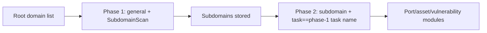

---

## name: scopesentry-mcp
description: Manage the ScopeSentry security scanning platform (projects, tasks, templates, assets, nodes) through the ScopeSentry MCP. Use when the user mentions ScopeSentry, MCP, API Key, scan tasks, or asset queries.

# ScopeSentry MCP Usage Guide

For users of an **already deployed ScopeSentry instance**. Connect to the platform through Cursor (or another MCP client); no local source code is required.

## 1. Preparation

### 1.1 Confirm the service is reachable

- Default web interface: `http://<host>`
- MCP endpoint: `http://<host>/mcp` (if a reverse proxy or front-end proxy sits in front, use the actual `/mcp` address)

### 1.2 Create an API Key

1. Log in to the ScopeSentry web interface in a browser
2. Go to the **API Key** management page and create a key (or create one through the endpoint provided by the administrator)
3. Save the returned `ssk_...` string (**displayed only once**)

### 1.3 Configure the Cursor MCP

Cursor → Settings → MCP → Add server:

```json
{
  "mcpServers": {
    "scopesentry": {
      "url": "http://<your-host>:8082/mcp",
      "headers": {
        "X-API-Key": "ssk_your-key"
      }
    }
  }
}
```

You can also use: `Authorization: Bearer ssk_your-key`

After configuration, restart MCP or reload Cursor, and confirm that the tool list contains `list_projects`, `list_assets`, and so on.

---

## 2. Tool Overview


| Tool                   | Purpose                                        |
| ---------------------- | ---------------------------------------------- |
| `list_projects`        | Project tree grouped by tag (includes project IDs) |
| `list_projects_data`   | Paginated project list, searchable by name     |
| `get_project`          | Project details                                |
| `create_project`       | Create a project                               |
| `list_tasks`           | List scan tasks                                |
| `get_task`             | Task details                                   |
| `list_scan_templates`  | List scan templates                            |
| `get_scan_template`    | Template details                               |
| `list_plugin_modules`  | Scan pipeline module names                     |
| `list_plugins`         | Available plugins (including hash and default parameters) |
| `create_scan_template` | Create a scan template                         |
| `create_scan_task`     | Create a scan task                             |
| `list_assets`          | Query assets of various types (paginated list) |
| `count_assets`         | Count assets (`/api/assets/common/total`)      |
| `get_asset_detail`     | Asset or vulnerability details                 |
| `add_asset_tag`        | Add a tag to an asset                          |
| `list_nodes`           | List scan nodes                                |


Tool parameters are governed by the MCP tool descriptions (schema); the search and filter syntax of `list_assets` / `count_assets` is identical, so you can read the `list_assets` description before querying assets.

When you need to know "how many records in total", use `count_assets` (corresponding to the web pagination total endpoint); there is no need to page through `list_assets` repeatedly just to count the total.

---

## 3. Common Workflows

### 3.1 Query assets by project

When the user or the context **already has a project condition**, prefer including `filter.project` to narrow the scope, avoiding too much cross-project data slowing down the response. If there is no explicit project, you are not required to add a project filter.

1. Use `list_projects` or `list_projects_data` to get the target project's **ObjectID** (`id` / `children[].value`)
2. Pass `filter.project` to `list_assets` (**must be an ID; do not write the project display name**)

```json
{
  "asset_type": "asset",
  "pageIndex": 1,
  "pageSize": 20,
  "search": "domain=^example.com",
  "filter": {
    "project": ["<project-ObjectID>"]
  }
}
```

### 3.2 Create a scan task

1. `list_nodes` to get online node names
2. `list_scan_templates` or `create_scan_template` to get the template **ObjectID**
3. `create_scan_task`: `name` and `node` are required; `template` takes the template ID (do not enter the template name)

**Target source `targetSource` (same as the web side):**

| targetSource | Description | Required parameters |
| --- | --- | --- |
| `general` | Enter targets directly | `target` |
| `project` | Read targets from a project | `project` (array of project ObjectIDs) |
| `asset` | Search the web asset library | `search`; optional `project`, `filter`, `targetNumber` |
| `RootDomain` | Search the root domain library | `search`; optional `project`, `filter`, `targetNumber` |
| `subdomain` | Search the subdomain library | `search`; optional `project`, `filter`, `targetNumber` |
| `UrlScan` | Search URL scan results | `search`; optional `project`, `filter`, `targetNumber` |
| `*Source` (e.g. `subdomainSource`) | Create from "select/search" on the asset page | use `search` when `targetTp=search`; use `targetIds` when `targetTp=select` |

**Example — scan root domains directly:**

```json
{
  "name": "example-subdomain-collection",
  "node": ["node-1"],
  "template": "<template-ObjectID>",
  "targetSource": "general",
  "target": "example.com\nfoo.com",
  "project": ["<project-ObjectID>"]
}
```

**Example — continue scanning from the subdomain library (filter by the previous task name):**

```json
{
  "name": "example-ports-and-vulnerabilities",
  "node": ["node-1"],
  "template": "<follow-up-module-template-ObjectID>",
  "targetSource": "subdomain",
  "search": "task==\"example-subdomain-collection\"",
  "project": ["<project-ObjectID>"]
}
```

### 3.3 Full information gathering for root domains (two phases recommended)

When the input is a **root domain** and you need **full information gathering**, it is recommended to run two scans rather than the whole pipeline at once.

**Reason:** Distributed tasks are dispatched per **single target**. When a root domain is the target, a node that receives that root domain will also continue to run subsequent modules against the subdomains it discovers on that node, which easily causes uneven load, slow speed, and errors.

**Best practices:**

1. **Phase 1 — subdomain collection only**
   - `targetSource`: `general`
   - `target`: all root domains (multiple lines)
   - Template: enable only `SubdomainScan`, `SubdomainSecurity` (subdomain scanning + subdomain takeover)
   - Use `get_task` to wait for the task to complete

2. **Phase 2 — subsequent modules**
   - `targetSource`: `subdomain`
   - `search`: `task=="<phase-1-task-name>"` (exact task name match)
   - Optional `project` to narrow the scope
   - Template: port scanning, asset mapping, vulnerability scanning, etc. (may omit SubdomainScan)
   - Subdomains are dispatched to each node as independent targets, giving higher parallel efficiency

You can also filter by task name on the "Subdomain" asset page in the web interface and then use "Create task from subdomains", which has the same effect.



### 3.4 Create a scan template

1. `list_plugin_modules` → list of module names
2. `list_plugins` (optionally filtered by `module`) → each plugin's `hash` and default `parameter`
3. `create_scan_template`: use `modules` to specify "module → array of plugin hashes"

---

## 4. Asset Queries (`list_assets` / `count_assets`)

`count_assets` and `list_assets` use the same `asset_type`, `search`, and `filter`, and return `{ "total": N }`, corresponding to `/api/assets/common/total` on the web side.

```json
{
  "asset_type": "subdomain",
  "search": "task==\"some-task-name\"",
  "filter": {"project": ["<project-ObjectID>"]}
}
```

**Performance advice (applies to both `list_assets` / `count_assets`):** When a project condition exists, prefer `filter.project` to narrow the scope; in `search`, for indexed fields try to use `==` equality or `^` prefix matching (see [4.3](#43-search-search-expressions)) to avoid large-scale `=` fuzzy queries slowing down the response. When there is no project context, you are not required to add a project filter.

See the [4.4](#44-filter-exact-filtering) table for the asset types that support `filter.project`.

### 4.1 Asset types `asset_type`

`asset`, `RootDomain`, `subdomain`, `app`, `mp`, `UrlScan`, `SensitiveResult`, `DirScanResult`, `crawler`, `vulnerability`, `PageMonitoring`, `IPAsset`, `SubdomainTakerResult`

Alias examples: `web`→asset, `vuln`→vulnerability, `ip`→IPAsset, `url`→UrlScan

### 4.2 Parameter descriptions


| Parameter                | Description                                   |
| ------------------------ | --------------------------------------------- |
| `pageIndex` / `pageSize` | Pagination, default 1 / 20                    |
| `search`                 | Search expression (see next section)          |
| `filter`                 | Exact filter JSON (see next section)          |
| `sort`                   | Only UrlScan and DirScanResult support sorting by `length` |
| `sid`                    | SensitiveResult only: sensitive rule name     |


`search` and `filter` **can be used at the same time**.

### 4.3 search search expressions

Custom DSL (**not SQL**):


| Operator | Meaning | Index | Example                       |
| ---- | ---- | ---- | --------------------------- |
| `=`  | Fuzzy match (regex) | does not use the index | `domain=example`            |
| `==` | Exact match (equality) | **uses the index** | `port==443`                 |
| `!=` | Exclude   | — | `port!="80"`                |
| `&&` | AND    | — | `domain==example.com && port==443` |
| `||` | OR    | — | `title=admin || body=login` |


**Indexes and operators:** Fields such as `domain`, `ip`, `port`, and `title` are indexed, but only **`==` equality** or **prefix matching where the value starts with `^`** (e.g. `domain=^example.com`) can use the index; **`=` is converted to a regex fuzzy match and cannot use the index**, so it easily becomes slow with large data volumes.

**search fields common to all types:** `tag`, `task` (task name), `rootDomain`

**project cannot be written in search** (it is invalid or errors when combined with `&&`). To filter by project, use `filter.project`.

**Common search fields by type:**


| asset_type           | Fields                                                                              |
| -------------------- | ----------------------------------------------------------------------------------- |
| asset                | domain, ip, port, service, app, title, statuscode, icon, banner, type, body, header |
| RootDomain           | domain, icp, company                                                                |
| subdomain            | domain, ip, type, value                                                             |
| app                  | name, icp, company, category, description, url, apk                                 |
| mp                   | name, icp, company, category, description, url                                      |
| UrlScan              | url, input, source, resultId, type                                                  |
| SensitiveResult      | url, sname, body, info, md5                                                         |
| DirScanResult        | url, statuscode, redirect, length                                                   |
| vulnerability        | url, vulname, matched, request, response, level                                     |
| crawler              | url, method, body, resultId                                                         |
| PageMonitoring       | url, hash, diff, response                                                           |
| IPAsset              | ip, domain, port, service, webServer, app                                           |
| SubdomainTakerResult | domain, value, type, response                                                       |


**search examples:**

- `domain==www.example.com && port==443` (equality, uses the index)
- `domain=^example.com` (prefix match, uses the index)
- `ip==192.168.1.1`
- `task=="some-task-name"`
- `level==high` (vulnerability)
- `statuscode==200` (DirScanResult)

Use `=` again only when fuzzy containment is needed, e.g. `title=admin` (does not use the index; best combined with conditions such as project to narrow the scope).

### 4.4 filter exact filtering

JSON object: multiple values for the same key are **OR**, while different keys are **AND**.

**Prefer `project` when a project condition exists:** If the user or context has already identified a project and the asset_type supports `project`, include it to narrow the scope; when there is no project information, it is not mandatory.


| filter key   | Meaning      | Value description                                        |
| ------------ | -------- | -------------------------------------------------------- |
| `project`    | Owning project | **ObjectID**, obtained with `list_projects` / `list_projects_data` |
| `task`       | Source task | **Task name**, the `name` from `list_tasks`              |
| `port`       | Port       | e.g. `"443"`                                            |
| `service`    | Service/protocol | e.g. `"https"`                                     |
| `app`        | Application fingerprint | e.g. `"Nginx"`                                |
| `icon`       | Icon hash  |                                                          |
| `statuscode` | HTTP status code | Mainly for asset                                  |
| `status`     | Status     | UrlScan/DirScan HTTP code; vulnerability/sensitive information handling status |
| `level`      | Vulnerability level | critical / high / medium / low / info            |
| `type`       | Type       | e.g. subdomain record types A, CNAME                    |
| `color`      | Sensitive rule color | SensitiveResult                                |
| `sname`      | Sensitive rule name | SensitiveResult                                 |
| `tags`       | Tags       |                                                          |


**Available filter keys by type:**


| asset_type                            | filter key                                                      |
| ------------------------------------- | --------------------------------------------------------------- |
| asset                                 | project, port, service, app, icon, statuscode, type, task, tags |
| RootDomain                            | project, tags                                                   |
| subdomain                             | project, type, task, tags                                       |
| app / mp                              | project, tags                                                   |
| UrlScan                               | status, tags                                                    |
| DirScanResult                         | status, tags                                                    |
| SensitiveResult                       | status, color, sname, tags                                      |
| crawler                               | project, task, tags                                             |
| vulnerability                         | project, level, status, task, tags                              |
| PageMonitoring / SubdomainTakerResult | tags                                                            |
| IPAsset                               | project, port, service, app                                     |


**filter example:**

```json
{"project": ["<project-ObjectID>"], "port": ["443"]}
```

**Combined query example:**

```json
{
  "asset_type": "asset",
  "search": "domain=^baidu && port==443",
  "filter": {"project": ["<project-ObjectID>"]},
  "pageIndex": 1,
  "pageSize": 10
}
```

**Notes:**

- When a project condition exists, prefer including `filter.project` (when supported); when there is no project context, it is not mandatory
- Do not put the project display name in `filter.project`
- Use `==` for known values and `^` for prefixes; avoid overusing `=` fuzzy matching on large tables
- For UrlScan, use `filter.status` for the HTTP status; DirScanResult can use `statuscode==200` in search
- For SensitiveResult by rule name: use `sname=rule-name` in `search`, or `filter.sname`

### 4.5 Sorting `sort`

Only **UrlScan** and **DirScanResult** support sorting:

```json
{"length": "ascending"}
```

Other types ignore `sort` and default to time-based ordering.

---

## 5. Scan template module names

`TargetHandler`, `SubdomainScan`, `SubdomainSecurity`, `PortScanPreparation`, `PortScan`, `PortFingerprint`, `AssetMapping`, `AssetHandle`, `URLScan`, `WebCrawler`, `URLSecurity`, `DirScan`, `VulnerabilityScan`, `PassiveScan`

---

## 6. Troubleshooting


| Symptom        | Resolution                                          |
| --------- | -------------------------------------------------- |
| MCP has no tools   | Check the URL, API Key, and whether ScopeSentry is running |
| 401 / 403 | Re-create or replace the API Key                    |
| Assets not found     | Confirm `filter.project` is an ObjectID; do not write project in search |
| Template/task creation fails | `template` must be the template ObjectID; `node` must be the online node name |
| Queries are slow/stuck   | Add `filter.project` when a project exists; for indexed fields in search, use `==` or the `^` prefix instead of `=`; reduce `pageSize` |


---
